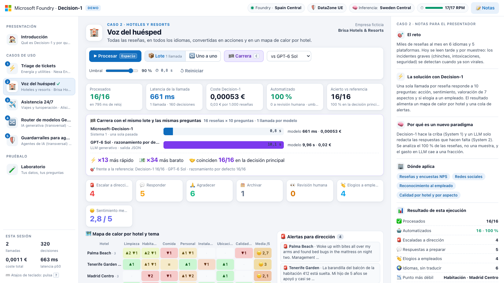
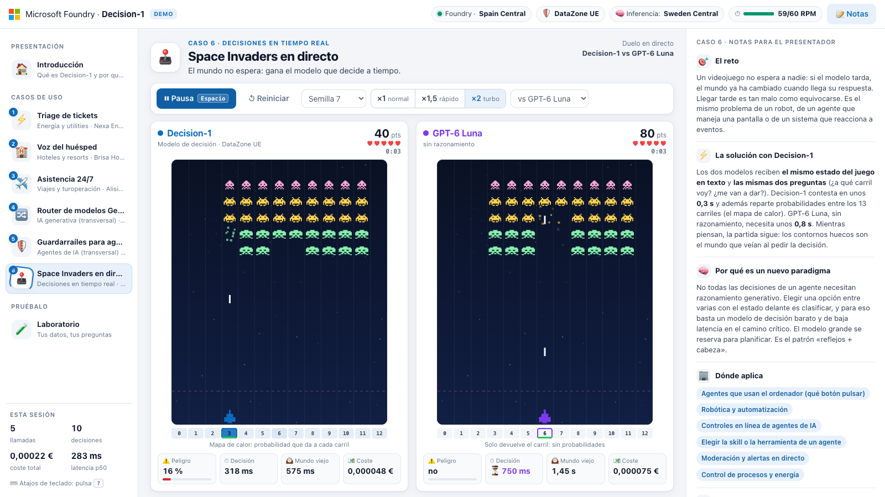
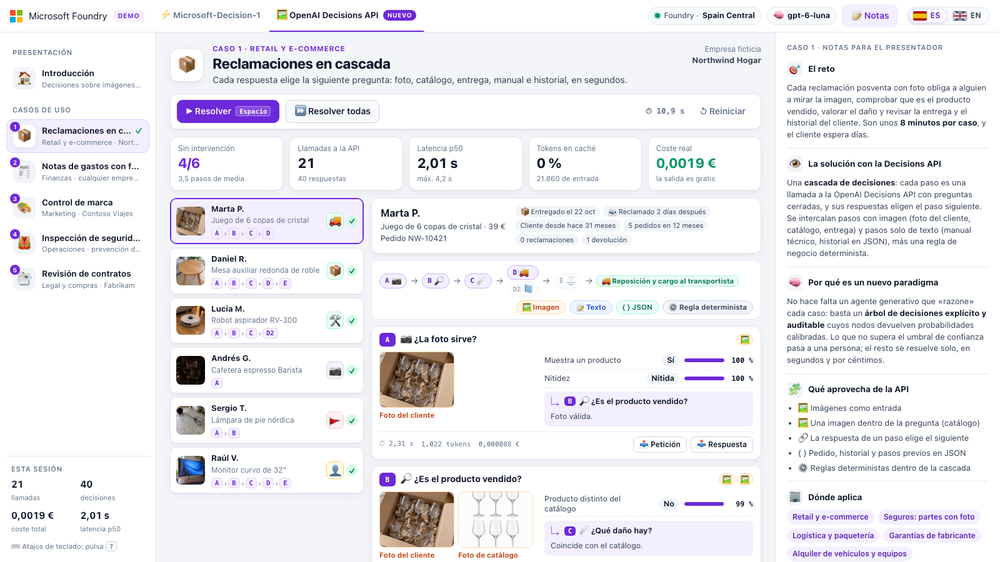
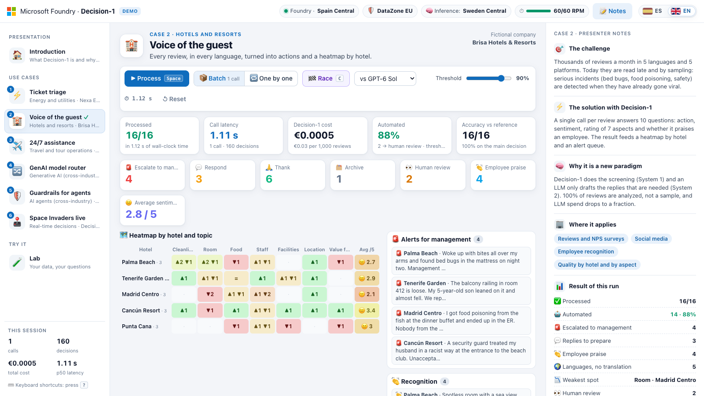

# Microsoft-Decision-1 y OpenAI Decisions API · demo en Microsoft Foundry

Web lista para desplegar con `azd up` que enseña, en vivo y con datos de ejemplo, qué aporta **Microsoft-Decision-1**, el nuevo modelo de decisiones rápidas de Microsoft Foundry. **No escribe, decide:** recibe un estado (un ticket, una reseña, la acción de un agente…) y preguntas cerradas, y en unos cientos de milisegundos devuelve cada respuesta con su probabilidad calibrada.

Una segunda pestaña enseña la **OpenAI Decisions API**, también disponible en Foundry, que decide igual pero **sobre imágenes y texto**: fotos de clientes, tiques, anuncios, centros de trabajo y contratos completos, con decisiones encadenadas en cascada. Consulta [Segunda pestaña · OpenAI Decisions API](#segunda-pestaña--openai-decisions-api).



## Por qué es un nuevo paradigma

| | LLM generativo (sistema 2) | Microsoft-Decision-1 (sistema 1) |
|---|---|---|
| Qué devuelve | Texto que hay que interpretar y validar | Una de las opciones que defines, con su probabilidad |
| Latencia | Segundos por respuesta | Cientos de milisegundos por llamada, con decenas de decisiones dentro |
| Precio | Entrada y salida (la salida es lo caro) | 0,042 $ por millón de tokens de entrada; la salida es gratis |
| Control | Difícil decidir cuándo fiarse | Un umbral de confianza decide qué se automatiza y qué revisa una persona |

Muchas decisiones de negocio no necesitan generar texto: clasificar, priorizar, enrutar, filtrar o aprobar. Con Decision-1 cuestan céntimos por cada mil y se aplican **a cada evento y en línea**, no a una muestra ni en diferido. El LLM queda para lo que de verdad aporta: redactar, resumir y razonar en abierto.

## Qué incluye

Una web de tres columnas pensada para presentar, con dos pestañas arriba: **Microsoft-Decision-1** (6 casos y un laboratorio) y **OpenAI Decisions API** (5 casos con imágenes). La tecla T cambia de pestaña, y cada pestaña recuerda la página en la que te quedaste.

- **Izquierda:** introducción y casos de uso de la pestaña; en la de Decision-1, también el laboratorio.
- **Centro:** la demo en vivo de cada caso, con KPIs (latencia, coste, automatización y acierto) y una vista visual distinta por caso.
- **Derecha:** notas visibles para la audiencia. Incluyen el reto, la solución, por qué es un nuevo paradigma, dónde aplica, el resultado de la ejecución y una **proyección mensual de ahorro** con supuestos editables.
- **Arriba a la derecha:** el selector de idioma, con las banderas de España y del Reino Unido. Cambia toda la demo entre español e inglés (consulta [Idiomas](#idiomas-español-e-inglés)).

| # | Caso | Sector | Qué decide Decision-1 | Elementos × preguntas | Latencia (1 llamada) | Coste del lote | Acierto |
|---|---|---|---|---|---|---|---|
| 1 | ⚡ Triage de tickets | Energía y utilities | Cola, urgencia, riesgo para la seguridad, cliente vulnerable y riesgo de baja de cada ticket (kanban por colas) | 16 × 5 | 0,93 s | 0,00033 € | 16/16 |
| 2 | 🏨 Voz del huésped | Hoteles y resorts | Acción, sentimiento, 7 aspectos y elogios a empleados de cada reseña (mapa de calor por hotel y alertas) | 16 × 10 | 0,68 s | 0,00053 € | 16/16 |
| 3 | ✈️ Asistencia 24/7 | Viajes y turoperación | Equipo, urgencia, si el viajero ya está en destino y si hay oportunidad de venta (bandeja priorizada) | 16 × 4 | 0,75 s | 0,00031 € | 16/16 |
| 4 | 🔀 Router de modelos GenAI | Transversal | A dónde va cada petición: respuesta predefinida, modelo pequeño, modelo grande o persona | 14 × 4 | 0,50 s | 0,00019 € | 14/14 |
| 5 | 🛡️ Guardarraíles para agentes | Transversal | Si cada acción de un agente se permite, pide aprobación humana o se bloquea (prompt injection, datos sensibles, límites) | 12 × 5 | 0,56 s | 0,00019 € | 12/12 |

Estas cifras se midieron el 10 de octubre de 2026 en la web desplegada (Spain Central, DataZone UE), con todo el caso en una sola llamada. Las empresas de los casos (Nexa Energía, Brisa Hotels & Resorts y Alisio Travel Group) son ficticias, y los datos son de ejemplo. El caso 6 no es un lote, sino un duelo en tiempo real: se describe después de los atajos de teclado.

Además:

- **Modo lote o uno a uno (tecla B).** En modo lote, todo el caso viaja en **una sola llamada** de hasta 255 preguntas. En modo uno a uno, se hace una llamada por elemento.
- **Umbral de confianza.** Lo que no lo supera pasa a revisión humana.
- **Carrera (tecla C).** Resuelve el mismo lote con las mismas preguntas, a la vez, con Decision-1 y con un LLM desplegado a tu elección (GPT-6 Sol, GPT-6 Luna o GPT-5.4 mini, con salida JSON). En el caso 2 se midió 0,8 s frente a 10,1 s de GPT-6 Sol: ×13 más rápido, ×34 más barato y la misma decisión principal en 16 de 16.
- **Detalle de cada elemento y petición real.** Haz clic en un elemento para ver todas sus probabilidades. «Ver petición» y «Ver respuesta» muestran el JSON real intercambiado con Foundry.
- **Laboratorio (tecla L).** Prueba tu propio texto con tus preguntas, o parte de una de las 12 plantillas. Hay 5 de negocio (calidad de llamadas, datos personales, relevancia para RAG, moderación de redes y una desde cero) y 7 de agentes.

| Tecla | Acción |
|---|---|
| ← → | Página anterior o siguiente |
| 0 · 1–6 · L | Introducción, caso 1–6 o laboratorio |
| Espacio | Procesar el caso (en el caso 6, iniciar o pausar la partida) |
| C | Carrera contra un LLM (casos 1–5) |
| B | Cambiar entre lote y uno a uno (casos 1–5) |
| R | Reiniciar el caso o la partida |
| T | Cambiar de pestaña |
| N | Mostrar u ocultar las notas |
| Ctrl + Enter | Decidir en el laboratorio |
| ? | Ver los atajos |

### Caso 6 · Space Invaders en directo (Decision-1 contra GPT-6 Luna)



Es el único caso que no es un lote: es una **decisión en tiempo real**. Dos tableros idénticos (misma semilla y mismas reglas) se juegan a la vez, uno con Decision-1 y otro con GPT-6 Luna. Cada segundo, la web describe el estado de la partida en texto y hace a cada modelo las mismas dos preguntas: a qué carril (de 13) debe ir la nave y si una bomba la va a alcanzar. **El juego no espera al modelo:** si tarda, el mundo ya ha cambiado cuando llega su respuesta.

- **Qué se ve.** El contorno hueco es el mundo que veía el modelo al decidir y el triángulo, el carril al que mandó la nave. Decision-1 añade un mapa de calor con su probabilidad por carril. Cada tablero muestra el peligro, la latencia, la edad del mundo y el coste de cada decisión.
- **Controles.** Cinco semillas, velocidad ×1, ×1,5 o ×2 (acelera el mundo, no el modelo) y rival a elegir (GPT-6 Luna, GPT-6 Sol o GPT-5.4 mini). Espacio inicia o pausa la partida y R la reinicia.
- **Al terminar** aparece una comparativa con puntos, vidas, latencia, acierto por decisión, tokens y coste, y una lectura de por qué ganó cada uno.
- **Resultados.** A ×1 los dos llegan a tiempo y gana quien decide mejor: en nuestras pruebas, GPT-6 Luna ganó 4–2. Al acelerar el mundo (×1,5 y ×2), Decision-1 ganó 10 de 12. Por decisión contesta unas 2,3 veces más rápido (≈0,35 s frente a ≈0,8 s) y cuesta unas 3 veces menos; la calidad es parecida. Es una demostración, no un benchmark: una partida cambia con la semilla y la velocidad, y un bot clásico lo haría mejor.
- **Sin interfaz.** `node scripts/probar-juego.mjs` ejecuta las 29 pruebas del motor, sin red. `node scripts/partida.mjs --url http://localhost:8000 --semillas 7,11 --velocidad 1` juega partidas reales contra los modelos y resume el marcador (si la web pide código, añade `--code`). Requieren Node.js 22 o superior.
- **Requisitos.** Necesita GPT-6 Luna (se despliega por defecto; consulta [Configuración](#configuración)) y unas 60 RPM de Decision-1 para llevar una decisión por segundo.

## Decision-1 dentro de un agente

No todas las decisiones de un agente necesitan razonamiento generativo. Muchas son clasificaciones, selecciones o evaluaciones de riesgo. El patrón que propone la demo es que **el LLM ejecuta y Decision-1 decide, filtra y enruta**, antes y después de cada paso:

```text
Petición  →  Decision-1: skill · archivos · riesgo  →  LLM implementa  →  Decision-1: reglas · revisión · siguiente test
```

La introducción muestra este flujo, y cada etapa abre su plantilla en el laboratorio. Todas usan un repositorio ficticio de reservas de hotel:

| Plantilla | Qué decide | Preguntas |
|---|---|---|
| 🧭 Skill picker | Qué skill ejecutar (o ninguna), con qué modelo y si hay que pedir aclaración | 2 de elección, 1 sí/no y 1 escala |
| 📂 Archivos relevantes | Qué archivos abrir antes de tocar el código | 12 sí/no, ordenadas como ranking |
| 🗜️ Compactación de contexto | Qué mensajes conservar al compactar la conversación | 10 sí/no |
| 🛡️ Reglas del proyecto | Si un cambio infringe reglas (secretos, SQL, datos personales…); bloquea con un 80 % de confianza o más | 6 sí/no |
| 🔍 Revisión adaptativa | Qué riesgos tiene un cambio y qué nivel de revisión necesita | 7 sí/no y 1 de elección |
| 🌐 Testing en navegador | Siguiente acción en la página, si se cumplió el objetivo y si hay error | 1 de elección y 2 sí/no |
| 📋 Requisitos sin tests | Qué requisitos funcionales no tienen test | 6 sí/no |

Cada decisión tarda entre 0,3 y 0,5 s y cuesta milésimas de céntimo. Decision-1 no sustituye a las validaciones deterministas (tests, linters o escáneres de secretos). Úsalo para priorizar y filtrar, y combina los bloqueos con reglas deterministas.

## Segunda pestaña · OpenAI Decisions API



La [OpenAI Decisions API](https://developers.openai.com/api/docs/guides/decisions) ya está disponible en Microsoft Foundry con GPT-6 Luna. Como Decision-1, responde preguntas cerradas con probabilidades y no genera texto, pero añade tres cosas que esta pestaña aprovecha:

- **Imágenes como entrada,** mezcladas con texto y JSON: fotos de clientes, tiques, anuncios o centros de trabajo. Una pregunta también puede llevar su propia imagen de referencia, como la foto del catálogo en el caso 1.
- **Caché del prompt.** Lo que se repite entre llamadas (una política, una guía de marca o un contrato) cuesta una décima parte desde la segunda llamada.
- **Decisiones encadenadas.** La documentación recomienda una petición por decisión cuando una depende de otra. El caso 1 lo convierte en una cascada: cada respuesta elige la pregunta siguiente, y los pasos con imagen se alternan con pasos solo de texto.

| | Microsoft-Decision-1 | OpenAI Decisions API |
|---|---|---|
| Entrada | Texto o estado en JSON | Texto, JSON e imágenes (PNG, JPEG, WebP o GIF) |
| Tipos de pregunta | `choice`, `score` y `noul`, hasta 255 por llamada | `choice`, `score` y `predicate`, hasta 400 por llamada |
| Precio de entrada | 0,042 $ por millón de tokens | 0,10 $ por millón de tokens; 0,01 $ si están en caché |
| Precio de salida | Gratis | Gratis |
| Latencia medida por llamada | 0,3–1 s | Unos 2 s con una foto |
| Despliegue en la demo | `decision-1` | `gpt-6-luna` |

| # | Caso | Área | Qué decide la API | Entrada | Lote | Coste | En caché | Acierto |
|---|---|---|---|---|---|---|---|---|
| 1 | 📦 Reclamaciones en cascada | Retail y e-commerce | Si la foto sirve, si es el producto vendido, qué daño hay, si llegó dañado, si lo resuelve el cliente y si se repone sin revisión. Cada respuesta elige el paso siguiente | Según el paso: foto del cliente, del catálogo o de la entrega, manual técnico o historial en JSON | 6 reclamaciones · 21 llamadas · 11 s | 0,0019 € | 0 % | 6/6; 4 sin intervención |
| 2 | 🧾 Notas de gastos con foto | Finanzas | Legibilidad, categoría, importe, fecha, alcohol, factura con NIF y gasto personal. La política decide si se aprueba, se revisa, se rechaza o se pide el original | Foto del tique, datos declarados en JSON y política de gastos | 9 tiques × 7 preguntas · 9 llamadas · 9 s | 0,0011 € | 68 % | 9/9; 6 sin intervención |
| 3 | 🎨 Control de marca | Marketing | Logotipo (presente, deformado o recoloreado), paleta, legibilidad, precio, texto legal y personas reconocibles. Se publica, se corrige, va a Legal o se revisa | Creatividad, guía de marca y logotipos de referencia | 8 creatividades × 8 preguntas · 8 llamadas · 9 s | 0,0011 € | 65 % | 8/8 |
| 4 | 🦺 Inspección de seguridad | Operaciones y prevención de riesgos | Siete riesgos, si hay alguien expuesto y la gravedad. Una matriz de riesgos decide si se para, se corrige hoy, se programa o no hace falta actuar | Foto del centro de trabajo, o una tuya | 8 fotos × 9 preguntas · 8 llamadas · 7 s | 0,0016 € | 0 % | 8/8 |
| 5 | 📄 Revisión de contratos | Legal y compras | 60 comprobaciones por contrato en tres listas: Legal, Privacidad y seguridad, y Finanzas y compras | Contrato completo y 20 preguntas por lista | 3 contratos × 60 preguntas · 9 llamadas · 6 s | 0,003 € | 40 % | 180/180 |

Estas cifras se midieron el 25 de octubre de 2026 con el despliegue `gpt-6-luna` de Foundry (GlobalStandard), procesando cada caso completo, y varían ligeramente entre ejecuciones. Las empresas (Northwind Hogar, Fabrikam y Contoso Viajes) son ficticias, y las imágenes, sintéticas.

- **El modelo responde y el código decide.** La acción final sale de reglas escritas en el JSON de cada caso (la política de gastos, la guía de marca, la matriz de riesgos o las rutas de la cascada), así que cada decisión se puede auditar. «Petición» y «Respuesta» muestran el JSON real intercambiado con Foundry.
- **Umbral de confianza.** Si una respuesta que importa no es lo bastante segura, decide una persona.
- **Prueba con tu foto (caso 4).** Arrastra o elige una foto JPEG, PNG o WebP. El navegador la reduce a 1024 px antes de enviarla (el servidor admite hasta 3 MB), se evalúa en memoria y no se guarda.
- **Notas.** El panel derecho explica cada caso igual que en la primera pestaña, con su proyección mensual de ahorro.
- **Acierto.** Mídelo con `scripts/evaluar-dx.py` (consulta [Adaptar un caso a tu cliente](#adaptar-un-caso-a-tu-cliente)).

| Tecla | Acción en la segunda pestaña |
|---|---|
| ← → | Página anterior o siguiente |
| 0 · 1–5 | Introducción o caso 1–5 |
| Espacio | Procesar el caso; en el caso 1, resolver la reclamación seleccionada o la siguiente pendiente |
| R | Reiniciar el caso |
| T | Volver a la pestaña de Decision-1 |
| N | Mostrar u ocultar las notas |
| ? | Ver los atajos |

## Idiomas: español e inglés



El selector de la esquina superior derecha, con las banderas de España y del Reino Unido, cambia **toda la demo** de idioma sin recargar la página. El español es el idioma por defecto.

- **Qué cambia.** La interfaz, los ejemplos de los casos 1 a 5, las notas del panel derecho, la proyección de ahorro, las 12 plantillas del laboratorio y los textos del caso 6. En la segunda pestaña, los cinco casos con sus preguntas, la política de gastos, la guía de marca, el manual técnico y los contratos; las imágenes son las mismas en los dos idiomas.
- **Lo que ve el modelo también cambia.** En inglés, el contexto, las preguntas y los criterios que se envían a Decision-1 y a los LLMs van en inglés, y «Ver petición» muestra el JSON real en inglés. Los ejemplos que ya venían en otro idioma (francés, alemán, catalán…) no se traducen, para que siga viéndose que no hay que configurar nada por idioma. El caso 6 es la excepción: sus preguntas y el estado de la partida se envían siempre en español.
- **Al cambiar de idioma** se mantienen los resultados de los casos ya ejecutados y solo se recargan los textos. La partida del caso 6 en curso se queda en pausa con su marcador, y se reanuda con «Seguir».
- **Cómo se elige.** El navegador recuerda la última elección (`localStorage`, clave `d1-lang`). Con `?lang=en` o `?lang=es` en la URL se fuerza y se recuerda; por ejemplo, `https://app-xxxxxxxxxxxxx.azurewebsites.net/?lang=en&code=…`. La web le pide el idioma a la API con la cabecera `X-Demo-Lang`; sin ella, responde en español.
- **El inglés muestra un idioma menos.** Los ejemplos que estaban en español se traducen al inglés, así que el contador «Idiomas, sin traducir» baja en uno (en el caso 3 pasa de 6 a 5).
- **Acierto en inglés.** Frente a la referencia, el inglés da entre 73 y 74 de 74 (el español, 74 de 74). El único elemento limítrofe es M-315 del caso 3, una felicitación que a la vez pide un viaje parecido. Oscila entre «reservas» y «otros» con una confianza cercana a 0,5, por debajo del umbral, así que acaba en revisión humana igualmente; en español también es limítrofe (acierta con 0,74). Los criterios en inglés son traducción fiel de los españoles y no se han retocado para forzar la cifra. En la segunda pestaña, el inglés da el mismo resultado que el español en los cinco casos.

Para añadir o corregir una traducción:

| Qué | Dónde |
|---|---|
| Textos de la interfaz | `src/static/js/i18n/en/*.js`. El texto en español es la clave: `t('Procesar')`, y cada fragmento asigna su traducción |
| Ejemplos, preguntas y notas de los casos 1 a 6 | `src/scenarios/en/<mismo nombre>.json`: solo lo que cambia, sin tocar identificadores |
| Plantillas del laboratorio | `src/lab.en.json` |
| Casos de la segunda pestaña | `src/dx/en/<mismo nombre>.json` (solo lo que cambia) y `src/dx/textos/en/` (política, guía, manual y contratos) |
| Precios y etiquetas de las comparaciones | `source_en` y `label_en` en `src/pricing.json` |

Dos comprobaciones sin red: `node scripts/probar-i18n.mjs` (que no falte ninguna traducción ni quede un texto sin envolver) y `.venv/bin/python scripts/probar-idiomas.py --lang en` (que las traducciones de los casos y del laboratorio mantengan la misma estructura y los mismos identificadores que el original). Para medir el acierto del modelo en inglés, ejecuta `scripts/evaluar.py <caso> --lang en`, o `scripts/evaluar-dx.py <caso> --lang en` en la segunda pestaña (consulta [Adaptar un caso a tu cliente](#adaptar-un-caso-a-tu-cliente)).

## Despliegue

### Requisitos

- Una suscripción de Azure con cuota de Microsoft-Decision-1 y de GPT-6 Luna (consulta [Regiones y cuota](#regiones-y-cuota)).
- Permiso para crear asignaciones de roles, como Owner o Contributor más Role Based Access Control Administrator. La web y tu usuario reciben el rol *Cognitive Services User* sobre la cuenta de Foundry.
- [Azure Developer CLI (azd)](https://aka.ms/azd-install) y [Azure CLI](https://aka.ms/azcli). Se probó con azd 1.34.
- En Windows, PowerShell 7 (`pwsh`) para los hooks de azd.
- Python 3.10 o superior, solo para ejecutarlo en local.
- Node.js 22 o superior, solo si quieres probar el caso 6 sin interfaz (`scripts/probar-juego.mjs` y `scripts/partida.mjs`) o comprobar las traducciones (`scripts/probar-i18n.mjs`).

### Pasos

```bash
git clone https://github.com/jrubiosainz/Decision1-Foundry.git
cd Decision1-Foundry
azd auth login
azd env new decision1-demo                # crea el resource group rg-decision1-demo
azd env set AZURE_LOCATION spaincentral
azd up
```

Tarda unos 10 minutos: unos 2 de infraestructura y entre 5 y 8 de despliegue de la web, porque App Service instala las dependencias en el primer arranque. Al terminar, azd muestra el enlace con el código de acceso:

```text
Demo lista -> https://app-xxxxxxxxxxxxx.azurewebsites.net/?code=d1-xxxxxxxx
```

Abre ese enlace una vez. El navegador guarda el código y lo quita de la barra de direcciones, así que no se ve al proyectar. Para recuperarlo, ejecuta `azd env get-value DEMO_ACCESS_CODE`. Para cambiarlo, ejecuta `azd env set DEMO_ACCESS_CODE <nuevo>` y después `azd provision`.

Qué se despliega:

- Una cuenta de Microsoft Foundry con un proyecto, con la autenticación local desactivada (solo Entra ID, sin claves).
- El despliegue `decision-1` de Microsoft-Decision-1, los LLMs de la carrera (`gpt-5.4-mini` y `gpt-6-sol`) y `gpt-6-luna`, el rival del caso 6 y el modelo de la segunda pestaña (OpenAI Decisions API).
- Un App Service Linux (B1 por defecto) con Python 3.12 e identidad administrada.
- El rol *Cognitive Services User* para la identidad de la web y para tu usuario.

### Configuración

Cambia estos valores con `azd env set <VARIABLE> <valor>` antes de ejecutar `azd up` o `azd provision`.

| Variable | Valor por defecto | Para qué sirve |
|---|---|---|
| `AZURE_LOCATION` | `spaincentral` | Región de la cuenta de Foundry y de la web |
| `DECISION_SKU` | `DataZoneStandard` | `DataZoneStandard` procesa dentro de la zona de datos (UE o EE. UU.); `GlobalStandard` puede procesar en cualquier región de Azure |
| `DECISION_CAPACITY` | `60` | Capacidad de Decision-1, en peticiones por minuto (RPM). El caso 6 hace una decisión por segundo, así que necesita unas 60; los casos 1 a 5 usan muy pocas |
| `COMPARISON_MODELS` | `gpt-5.4-mini,gpt-6-sol` | LLMs para la carrera, separados por comas (`nombre` o `nombre:versión`). Si la dejas vacía, no hay carrera |
| `COMPARISON_SKU` | `DataZoneStandard` | SKU de los LLMs de la carrera |
| `COMPARISON_CAPACITY` | `50` | Miles de tokens por minuto de cada LLM de la carrera |
| `GAME_MODEL` | `gpt-6-luna` | LLM rival del caso 6 y modelo de la segunda pestaña (`nombre` o `nombre:versión`). La OpenAI Decisions API solo admite `gpt-6-luna`. Con `none` no se despliega: el caso 6 usa el primer LLM de la carrera y la segunda pestaña no funciona, salvo que `COMPARISON_MODELS` incluya `gpt-6-luna` |
| `GAME_SKU` | `GlobalStandard` | SKU de ese LLM. Con `DataZoneStandard`, el procesamiento se queda en la zona de datos de la UE, pero cuesta un 20 % más y necesita cuota DataZone |
| `GAME_CAPACITY` | `100` | Miles de tokens por minuto del LLM del caso 6 y de la segunda pestaña |
| `APP_SERVICE_SKU` | `B1` | Plan de App Service de la web. `F1` es gratuito, pero se duerme tras unos 20 minutos sin uso y no admite Always On |
| `DEMO_ACCESS_CODE` | Se genera (`d1-…`) | Código de acceso a la web |

La segunda pestaña llama al despliegue `gpt-6-luna`. Si en tu cuenta de Foundry tiene otro nombre, define la variable de entorno `DX_DEPLOYMENT` con ese nombre. No es una variable de azd: en local, defínela antes de `run-local`; en App Service, añádela en la configuración de la web y vuelve a hacerlo después de cada `azd provision`.

### Regiones y cuota

Microsoft-Decision-1 está disponible (octubre de 2026) en:

| SKU | Regiones |
|---|---|
| DataZone UE (7) | spaincentral, swedencentral, westeurope, francecentral, germanywestcentral, italynorth y polandcentral |
| DataZone EE. UU. (9) | eastus, eastus2, centralus, northcentralus, southcentralus, westcentralus, westus, westus2 y westus3 |
| GlobalStandard | 31 regiones |

La cuota DataZone **se comparte entre todas las regiones de la zona**. Los valores por defecto dependen de la suscripción: en la nuestra de pruebas hay 60 RPM de Decision-1, tanto con DataZone (para toda la UE) como con GlobalStandard, y en otras hemos visto 17 RPM con DataZone y 50 con GlobalStandard. Los casos 1 a 5 trabajan en modo lote, con una llamada por caso, y casi no gastan cuota. El caso 6 sí necesita ritmo: hace una llamada por segundo, unas 60 RPM. Con menos cuota funciona igual, pero la web espacia las decisiones (con 17 RPM, una cada 3,7 s aproximadamente) y la nave reacciona más tarde. Si la suscripción ya tiene otro despliegue DataZone de Decision-1 en la UE, usa GlobalStandard:

```bash
azd env set DECISION_SKU GlobalStandard
azd env set DECISION_CAPACITY 60          # ajústalo a tu cuota disponible
```

Para consultar tu cuota:

```bash
az cognitiveservices usage list -l spaincentral --query "[?contains(name.value,'Decision')]" -o table
az cognitiveservices usage list -l spaincentral --query "[?contains(name.value,'gpt-6-luna')]" -o table
```

Si no tienes cuota de GPT-6 Sol, ejecuta `azd env set COMPARISON_MODELS gpt-5.4-mini`. Si no tienes cuota de GPT-6 Luna, ejecuta `azd env set GAME_MODEL none`: el caso 6 usará el primer LLM de la carrera como rival, pero la segunda pestaña no funcionará, porque la OpenAI Decisions API solo admite GPT-6 Luna.

## Ejecutar en local

```bash
./scripts/run-local.sh       # macOS o Linux
./scripts/run-local.ps1      # Windows
```

El script carga las variables del entorno de azd, crea un entorno virtual `.venv` y arranca la web en <http://127.0.0.1:8000>, que en local no pide código. Se autentica con tu sesión de `az login` o `azd auth login`, mediante Entra ID y sin claves. Requiere haber ejecutado `azd up` o `azd provision` antes.

## Llamar a la API directamente

Es una sola petición HTTP, sin SDK:

```bash
ENDPOINT=$(azd env get-value AZURE_AI_ENDPOINT)
TOKEN=$(az account get-access-token --resource https://cognitiveservices.azure.com --query accessToken -o tsv)

curl -s "$ENDPOINT/providers/microsoft/v1/systemone" \
  -H "Authorization: Bearer $TOKEN" -H "Content-Type: application/json" \
  -d '{
    "model": "decision-1",
    "state": { "canal": "WhatsApp", "mensaje": "Huele mucho a gas en el portal y no sé a quién llamar" },
    "questions": {
      "cola": { "type": "choice", "instructions": "¿A qué equipo debe ir el ticket?",
                "criteria": { "averias": "Averías y emergencias", "facturacion": "Facturación y pagos", "otros": "Cualquier otra consulta" } },
      "urgencia": { "type": "score", "instructions": "¿Con qué urgencia hay que atenderlo?",
                    "criteria": ["Puede esperar", "Hoy", "Inmediata"] },
      "seguridad": { "type": "noul", "instructions": "¿Hay riesgo para la seguridad de las personas?" }
    }
  }'
```

Respuesta, resumida:

```json
{
  "model": "microsoft-decision-1",
  "answers": {
    "cola":      { "type": "choice", "choice": "averias", "confidence": 0.92,
                   "probabilities": { "averias": 0.946, "facturacion": 0.001, "otros": 0.053 } },
    "urgencia":  { "type": "score", "score": 2.0, "confidence": 0.99,
                   "legend": { "0": "Puede esperar", "1": "Hoy", "2": "Inmediata" },
                   "probabilities": { "0": 0.00003, "1": 0.00002, "2": 0.99994 } },
    "seguridad": { "type": "noul", "noul": 0.9996 }
  },
  "usage": { "input_tokens": 130, "output_tokens": 3 }
}
```

Hay tres tipos de pregunta:

- **`choice`:** elige entre las opciones de `criteria`, un diccionario de clave y descripción.
- **`score`:** una escala ordenada; `criteria` es la lista de niveles.
- **`noul`:** una pregunta de sí o no que devuelve la probabilidad de «sí».

Admite hasta 255 preguntas por llamada, un estado de hasta 64.000 tokens y un cuerpo de hasta 1 MiB. El token se pide para `https://cognitiveservices.azure.com` y no hace falta `api-version`.

### Con imágenes: OpenAI Decisions API

La segunda pestaña usa otra ruta del mismo recurso, con el mismo token. Desde la raíz del repo, con una de las fotos de la demo:

```bash
ENDPOINT=$(azd env get-value AZURE_AI_ENDPOINT)
TOKEN=$(az account get-access-token --resource https://cognitiveservices.azure.com --query accessToken -o tsv)
FOTO=$(base64 < src/static/img/dx/seguridad/s4-escalera.jpg | tr -d '\n')

curl -s "$ENDPOINT/openai/v1/decisions" \
  -H "Authorization: Bearer $TOKEN" -H "Content-Type: application/json" \
  -d @- <<EOF
{
  "model": "gpt-6-luna",
  "input": [
    { "role": "developer", "content": "Eres técnico de prevención de riesgos laborales." },
    { "role": "user", "content": [
      { "type": "input_text", "text": "Foto tomada hoy en el almacén de Madrid." },
      { "type": "input_image", "image_url": "data:image/jpeg;base64,$FOTO" }
    ] }
  ],
  "questions": [
    { "type": "predicate", "name": "altura",
      "instructions": "¿Hay alguien trabajando en altura sin protección o de forma insegura?" },
    { "type": "choice", "name": "accion", "instructions": "¿Qué hay que hacer?",
      "choices": [
        { "value": "parar", "description": "Parar la actividad ahora mismo" },
        { "value": "programar", "description": "Corregirlo en los próximos días" },
        { "value": "nada", "description": "No hace falta actuar" } ] },
    { "type": "score", "name": "gravedad", "instructions": "¿Qué gravedad tiene la situación?",
      "levels": [
        { "label": "Leve", "description": "Sin riesgo de lesión" },
        { "label": "Grave", "description": "Puede causar una lesión" },
        { "label": "Crítica", "description": "Riesgo de lesión grave ahora mismo" } ] }
  ]
}
EOF
```

Respuesta, resumida:

```json
{
  "model": "gpt-6-luna",
  "answers": [
    { "type": "predicate", "name": "altura", "probability": 0.96 },
    { "type": "choice", "name": "accion", "choice": "parar", "confidence": 1.0,
      "probabilities": [ { "value": "parar", "probability": 1.0 }, { "value": "programar", "probability": 0.0 },
                         { "value": "nada", "probability": 0.0 } ] },
    { "type": "score", "name": "gravedad", "score": 1.98, "confidence": 0.97,
      "probabilities": [ { "value": 0, "label": "Leve", "probability": 0.0 },
                         { "value": 1, "label": "Grave", "probability": 0.02 },
                         { "value": 2, "label": "Crítica", "probability": 0.98 } ] }
  ],
  "usage": { "input_tokens": 1145, "input_tokens_details": { "cached_tokens": 0, "cache_write_tokens": 0 },
             "output_tokens": 0 }
}
```

Los tipos de pregunta cambian un poco:

- **`predicate`:** una pregunta de sí o no que devuelve la probabilidad de «sí».
- **`choice`:** elige un `value` de `choices`, cada uno con su `description`.
- **`score`:** una escala de 2 a 10 `levels` ordenados; `score` es el nivel esperado, de 0 al último.

Admite hasta 400 preguntas y 128 imágenes (32 MB en total) por petición. Las `instructions` de una pregunta también pueden ser una lista de `input_text` e `input_image`, para comparar con una imagen de referencia. La caché se aplica cuando las peticiones comparten un prefijo de al menos 1.024 tokens: pon primero lo que se repite (la política, la guía o el contrato) y al final lo que cambia. En `usage.input_tokens_details`, `cached_tokens` son los tokens leídos de la caché y `cache_write_tokens`, los que se escribieron en ella.

## Costes

- **Decision-1:** 0,042 $ por millón de tokens de entrada; la salida es gratis. Cada lote de la demo cuesta entre 0,0002 € y 0,0005 €, es decir, de 0,01 € a 0,03 € por cada 1.000 elementos.
- **LLMs de la carrera:** se paga por uso. Una carrera con GPT-6 Sol cuesta unos 0,02–0,03 €.
- **Caso 6:** una decisión de Decision-1 cuesta unos 0,00002 € y una de GPT-6 Luna, unos 0,00007 € (3 veces más). Una partida completa sale por unos 0,001 € con Decision-1 y unos 0,004 € con GPT-6 Luna.
- **OpenAI Decisions API (segunda pestaña):** 0,10 $ por millón de tokens de entrada, 0,01 $ si se leen de la caché y 0,125 $ al escribirlos en ella; la salida es gratis. Cada caso cuesta entre 0,001 € y 0,003 € por ejecución. La caché lo abarata alrededor de un 60 % en los casos 2 y 3, y un 35 % en el 5.
- **App Service B1 Linux:** unos 11,5 € al mes en Spain Central. Es el único coste fijo mientras exista. Con `azd env set APP_SERVICE_SKU F1` es gratuito, pero se duerme tras unos 20 minutos sin uso.

Los precios que usan los cálculos de la web están en `src/pricing.json`. Para borrarlo todo, ejecuta `azd down --purge`; `--purge` elimina la cuenta de Foundry definitivamente y libera la cuota.

## Adaptar un caso a tu cliente

Cada caso es un JSON en `src/scenarios/`:

| Campo | Contenido |
|---|---|
| `context` | Descripción del negocio que acompaña a cada elemento |
| `questions` | Las preguntas (`choice`, `score` o `noul`) con sus `criteria` |
| `primary` | La pregunta principal, de tipo `choice`, que alimenta los KPIs y el acierto |
| `items` | Los ejemplos, con `expected` para medir el acierto |
| `state_fields` | Qué campos de cada elemento se envían al modelo |
| `view` | La vista del centro: `kanban`, `heatmap`, `inbox`, `router` o `guardrails` |
| `notes` | Los textos del panel derecho y los supuestos de ahorro (`savings`: volumen al mes, minutos por elemento y coste por hora) |

Lo más sencillo es copiar el caso más parecido y cambiar el contexto, las opciones y los ejemplos, sin cambiar los nombres de las preguntas que usa su vista. Después mide el acierto con el evaluador y despliega:

```bash
set -a; eval "$(azd env get-values)"; set +a
.venv/bin/python scripts/evaluar.py energia                       # acierto frente a "expected"
.venv/bin/python scripts/evaluar.py energia --lang en             # lo mismo con el caso en inglés
.venv/bin/python scripts/evaluar.py energia --llm gpt-5.4-mini    # comparado con un LLM
azd deploy
```

El entorno virtual `.venv` lo crea `scripts/run-local`.

**Versión en inglés.** Para que el caso también se vea en inglés, crea `src/scenarios/en/<mismo nombre>.json` con solo lo que cambia: los textos, las preguntas con sus criterios, los ejemplos (con el mismo `id`) y las notas. Los identificadores (nombres de preguntas, claves de opciones, `expected`, `view`…) no se traducen. Valídalo con `.venv/bin/python scripts/probar-idiomas.py --lang en`. Sin ese archivo, el caso se muestra en español aunque elijas inglés. Las plantillas del laboratorio se traducen en `src/lab.en.json`.

El caso 6 (`06-invaders.json`) es de otro tipo, `kind: game`: define `game` (`llm`, `seeds` y `speeds`), las dos preguntas del juego y las notas, pero no tiene `items` ni `view`. El motor del juego está en `src/static/js/game/`. `evaluar.py` lo omite; para medirlo usa `scripts/partida.mjs`.

**Casos de la segunda pestaña.** Cada uno es un JSON en `src/dx/`, y su `kind` elige la vista: `cascade` (reclamaciones), `receipts` (gastos), `creatives` (marca), `safety` (seguridad) o `contracts` (contratos). Define las preguntas (`predicate`, `choice` o `score`), los ejemplos con su resultado esperado (`expected`), las notas y lo que decide la acción: `rules` en gastos y marca, `policy` (la matriz de riesgos) en seguridad y las `route` de cada paso en la cascada. Los textos largos que van en caché (la política de gastos, la guía de marca, el manual técnico y los contratos) están en `src/dx/textos/`, y las imágenes, en `src/static/img/dx/`. La traducción va en `src/dx/en/` (solo lo que cambia) y en `src/dx/textos/en/`. La web valida cada caso al cargarlo. Para medir el acierto:

```bash
.venv/bin/python scripts/evaluar-dx.py                              # los cinco casos
.venv/bin/python scripts/evaluar-dx.py gastos --lang en --detalle   # un caso, en inglés y con todas las respuestas
```

## Seguridad

- **Sin claves.** La cuenta de Foundry tiene la autenticación local desactivada. La web usa su identidad administrada y, en local, tu sesión de Entra ID.
- **El código de acceso** solo evita que cualquiera con la URL consuma tu cuota; no autentica a los usuarios. Si la demo va a durar, activa la autenticación de App Service con Entra ID.
- **Residencia de datos.** Con DataZoneStandard, el procesamiento de Decision-1 y de los LLMs de la carrera se queda dentro de la zona de datos de la UE. GPT-6 Luna (caso 6 y segunda pestaña) se despliega en GlobalStandard por la cuota disponible, así que su procesamiento puede salir de la UE. El juego solo envía el estado de la partida, y la segunda pestaña, imágenes sintéticas y textos de ejemplo; si subes tu propia foto en el caso 4, también se procesa ahí. Para mantenerlo dentro de la UE, ejecuta `azd env set GAME_SKU DataZoneStandard` (necesita cuota DataZone de GPT-6 Luna).
- **Fotos subidas.** La web solo acepta JPEG, PNG o WebP de hasta 3 MB, comprueba el contenido y no solo la extensión, y no guarda la foto: la envía a Foundry y la descarta.

## Solución de problemas

| Síntoma | Causa y solución |
|---|---|
| `Insufficient quota … Available: 0` al volver a ejecutar `azd provision` | Es un falso positivo: esa cuota la consume tu propio despliegue. Continúa |
| `InsufficientQuota` en un entorno nuevo | La cuota DataZone de la zona ya está en uso en la suscripción. Usa GlobalStandard o elimina el otro despliegue |
| azd avisa de que no ha visto cambios de estado en 5 minutos | El primer arranque de App Service es lento. La web queda lista igualmente; compruébalo en `/healthz` |
| La web pide un código | Abre el enlace con `?code=`, o recupéralo con `azd env get-value DEMO_ACCESS_CODE` |
| Error 502 de Foundry con estado 401 o 403 recién desplegado | El rol de la identidad administrada tarda unos minutos en propagarse. Espera y recarga |
| Error 429 | Se han superado las RPM de Decision-1 y se agotaron los reintentos automáticos. Espera unos segundos o usa el modo lote; la cabecera de la web muestra las RPM disponibles. En el caso 6 la partida no se detiene: aparece «Límite de peticiones por minuto» y esa decisión se salta |
| La primera decisión tarda unos 3 s | El modelo está en frío tras unos minutos sin uso. La web lo calienta cada vez que cambias de página, así que normalmente ya está en caliente al pulsar «Procesar» |
| En el caso 6, la nave reacciona tarde o a tirones | La cuota de Decision-1 es menor de 60 RPM y la web espacia las decisiones. Sube `DECISION_CAPACITY` si tu cuota lo permite, o juega a ×1 |
| El caso 6 dice «Falta el modelo rival» | La web no tiene ningún LLM de comparación. Deja `GAME_MODEL` en `gpt-6-luna` o define `COMPARISON_MODELS`, y ejecuta `azd provision` |
| La segunda pestaña da un error 404 de Foundry (`DeploymentNotFound`) | Falta el despliegue `gpt-6-luna`, el único modelo que admite la OpenAI Decisions API. Deja `GAME_MODEL` en `gpt-6-luna` y ejecuta `azd provision`, o define `DX_DEPLOYMENT` (consulta [Configuración](#configuración)) |
| La segunda pestaña da un error 429 | Se han superado los tokens o las peticiones por minuto de GPT-6 Luna. Espera unos segundos o sube `GAME_CAPACITY` si tu cuota lo permite |
| La web tarda 10–30 s en abrir tras un rato sin uso | Pasa con el plan F1, que se duerme tras unos 20 minutos sin tráfico. Ábrela unos minutos antes de presentar, o usa B1 (`azd env set APP_SERVICE_SKU B1` y `azd provision`) |
| Con la web en inglés, un texto sigue en español | Falta su traducción. En la consola del navegador, `window.__d1Missing` lista las claves sin traducir; añádelas en `src/static/js/i18n/en/*.js`. Si es un ejemplo o una nota de un caso, falta en `src/scenarios/en/*.json` |
| Quieres localizar textos sin traducir a simple vista | En la consola, `localStorage.setItem('d1-pseudo', '1')` y recarga: cada texto traducible aparece entre ⟦ ⟧. Lo que se vea sin marcar no pasa por la traducción. Para quitarlo, `localStorage.removeItem('d1-pseudo')` |

## Estructura

```text
├── azure.yaml                  # azd: servicio web y hooks
├── infra/                      # Bicep: Foundry, modelos, App Service y roles
├── scripts/
│   ├── codigo-acceso.sh|ps1    # hook preprovision: genera el código de acceso
│   ├── run-local.sh|ps1        # ejecuta la web en local
│   ├── evaluar.py              # mide el acierto de los casos 1 a 5 (--lang en para la versión en inglés)
│   ├── evaluar-dx.py           # lo mismo para los casos de la segunda pestaña
│   ├── partida.mjs             # juega el caso 6 sin interfaz contra los modelos reales
│   ├── probar-juego.mjs        # 29 pruebas del motor del juego, sin red
│   ├── probar-i18n.mjs         # comprueba que la interfaz no deja textos sin traducir
│   └── probar-idiomas.py       # valida las traducciones de src/scenarios/en y src/lab.en.json
├── src/
│   ├── app.py                  # API (FastAPI) y web estática
│   ├── decision_client.py      # cliente de Foundry (Decision-1, Decisions API y LLMs) con Entra ID
│   ├── demo.py                 # peticiones, lotes y costes; carga los casos en el idioma pedido
│   ├── dx.py                   # segunda pestaña: peticiones a la Decisions API, cascada, reglas y costes
│   ├── dx/*.json               # sus 5 casos; en dx/en/, la traducción, y en dx/textos/, los textos largos
│   ├── scenarios/*.json        # los 6 casos en español: contexto, preguntas, ejemplos y notas
│   ├── scenarios/en/*.json     # su traducción al inglés (solo lo que cambia)
│   ├── lab.json                # plantillas del laboratorio
│   ├── lab.en.json             # las plantillas en inglés
│   ├── pricing.json            # precios para los cálculos
│   └── static/                 # web en HTML, CSS y JavaScript, sin compilación (el juego, en js/game/)
│       ├── js/dx/, css/dx.css  # vistas de la segunda pestaña
│       ├── img/dx/             # sus imágenes sintéticas
│       └── js/i18n.js, i18n/   # selector de idioma (langswitch.js) y diccionario en inglés (i18n/en/*.js)
└── docs/
    ├── GUION-DEMO.md           # guion para presentar la demo
    └── img/                    # capturas de una ejecución real
```

Para presentar la demo, sigue el [guion](docs/GUION-DEMO.md).

## Más información

- [Microsoft-Decision-1: Our model for fast decision-making](https://commandline.microsoft.com/microsoft-decision-1-model-foundry/): anuncio del modelo.
- [Microsoft-Decision-1 en el catálogo de Microsoft Foundry](https://ai.azure.com/catalog/models/Microsoft-Decision-1).
- [Decisions API](https://openai.com/index/decisions-api/): anuncio de OpenAI.
- [Guía de la Decisions API](https://developers.openai.com/api/docs/guides/decisions), en la documentación de OpenAI.
- [Decisions API en Microsoft Foundry](https://learn.microsoft.com/en-us/azure/foundry/openai/how-to/decisions), en Microsoft Learn.
