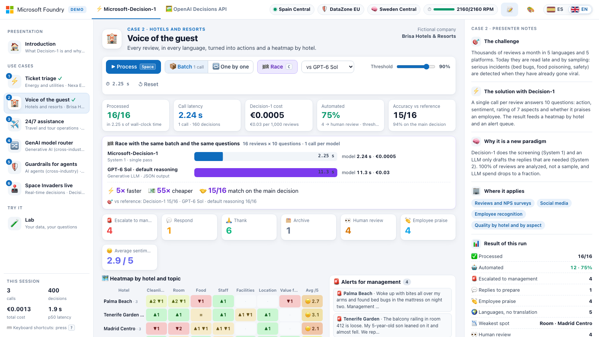
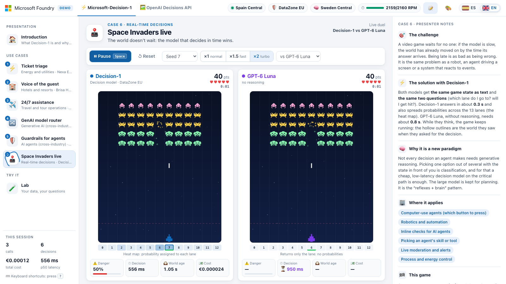
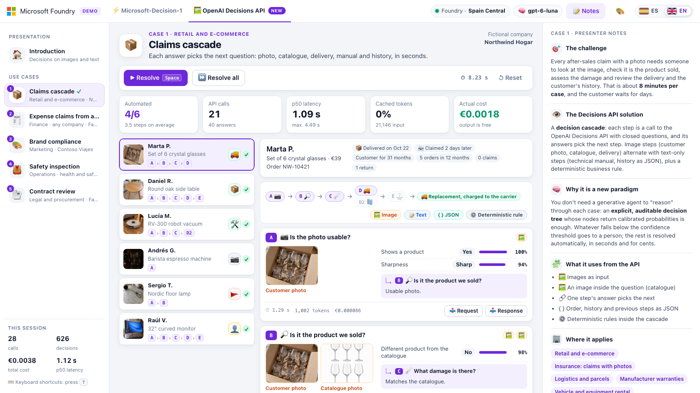
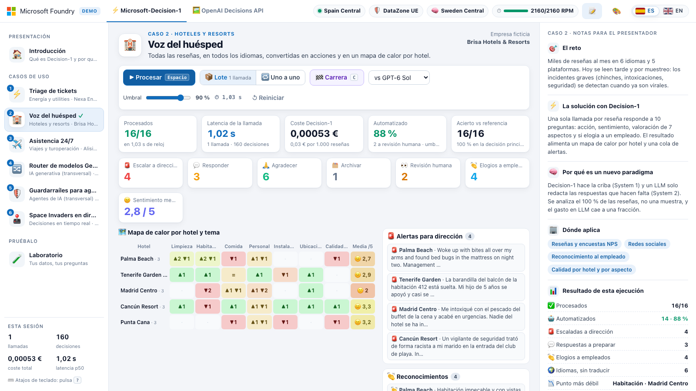
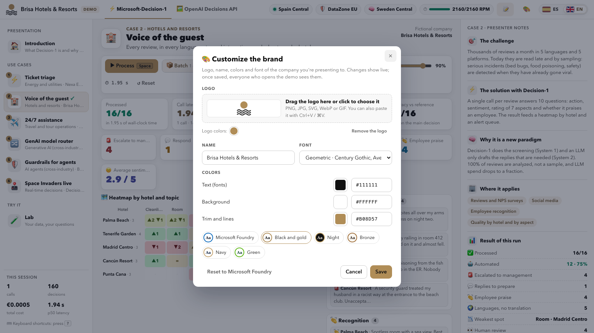

# Microsoft-Decision-1 and OpenAI Decisions API · demo on Microsoft Foundry

🇪🇸 [Leer en español](README.es.md)

A web app, ready to deploy with `azd up`, that shows live, with sample data, the value of **Microsoft-Decision-1**, the new fast decision-making model in Microsoft Foundry. **It doesn't write, it decides:** it receives a state (a ticket, a review, an agent's action…) and closed questions, and in a few hundred milliseconds it returns each answer with its calibrated probability.

A second tab shows the **OpenAI Decisions API**, also available in Foundry, which decides the same way but **on images and text**: customer photos, receipts, ads, workplaces and full contracts, with decisions chained in a cascade. See [Second tab · OpenAI Decisions API](#second-tab--openai-decisions-api).



## Why it is a new paradigm

| | Generative LLM (system 2) | Microsoft-Decision-1 (system 1) |
|---|---|---|
| What it returns | Text that has to be interpreted and validated | One of the options you define, with its probability |
| Latency | Seconds per answer | Hundreds of milliseconds per call, with dozens of decisions inside |
| Price | Input and output (output is the expensive part) | $0.042 per million input tokens; output is free |
| Control | Hard to decide when to trust it | A confidence threshold decides what gets automated and what a person reviews |

Many business decisions don't need to generate text: classifying, prioritizing, routing, filtering or approving. With Decision-1 they cost cents per thousand and are applied **to every event, inline**, not to a sample or after the fact. The LLM is left for what it really adds: writing, summarizing and open-ended reasoning.

## What's included

A three-column web app designed for presenting, with two tabs at the top: **Microsoft-Decision-1** (6 cases and a Lab) and **OpenAI Decisions API** (5 cases with images). The T key switches tabs, and each tab remembers the page you were on.

- **Left:** the tab's introduction and use cases; in the Decision-1 tab, the Lab too.
- **Center:** the live demo of each case, with KPIs (latency, cost, automation and accuracy) and a different visual view for each case.
- **Right:** notes visible to the audience. They include the challenge, the solution, why it is a new paradigm, where it applies, the result of the run and a **monthly savings projection** with editable assumptions.
- **Top right:** the language switcher, with the flags of Spain and the United Kingdom. It switches the whole demo between Spanish and English (see [Languages](#languages-spanish-and-english)). On laptop screens, the header compacts itself: it hides labels and secondary indicators so that it never covers the tabs or the notes button.
- **🎨 Client brand:** the 🎨 button in the header replaces the logo, name, colors and font with those of the company you're presenting to (see [Customize the brand](#customize-the-brand)).

| # | Case | Sector | What Decision-1 decides | Items × questions | Latency (1 call) | Batch cost | Accuracy |
|---|---|---|---|---|---|---|---|
| 1 | ⚡ Ticket triage | Energy and utilities | Queue, urgency, safety risk, vulnerable customer and churn risk of each ticket (kanban by queue) | 16 × 5 | 0.93 s | €0.00033 | 16/16 |
| 2 | 🏨 Voice of the guest | Hotels and resorts | Action, sentiment, 7 aspects and praise for staff in each review (heat map by hotel, and alerts) | 16 × 10 | 0.68 s | €0.00053 | 16/16 |
| 3 | ✈️ 24/7 assistance | Travel and tour operations | Team, urgency, whether the traveler is already at the destination and whether there's a sales opportunity (prioritized inbox) | 16 × 4 | 0.75 s | €0.00031 | 16/16 |
| 4 | 🔀 GenAI model router | Cross-industry | Where each request goes: predefined answer, small model, large model or a person | 14 × 4 | 0.50 s | €0.00019 | 14/14 |
| 5 | 🛡️ Guardrails for agents | Cross-industry | Whether each action of an agent is allowed, needs human approval or is blocked (prompt injection, sensitive data, limits) | 12 × 5 | 0.56 s | €0.00019 | 12/12 |

These figures were measured on October 10, 2026 in the deployed web app (Spain Central, DataZone EU), with the whole case in a single call. The companies in the cases (Nexa Energía, Brisa Hotels & Resorts and Alisio Travel Group) are fictitious, and the data is sample data. Case 6 isn't a batch but a real-time duel: it's described after the keyboard shortcuts.

Also:

- **Batch or one-by-one mode (B key).** In batch mode, the whole case travels in **a single call** of up to 255 questions. In one-by-one mode, there's one call per item.
- **Confidence threshold.** Anything below it goes to human review.
- **Race (C key).** Solves the same batch with the same questions, at the same time, with Decision-1 and with a deployed LLM of your choice (GPT-6 Sol, GPT-6 Luna or GPT-5.4 mini, with JSON output). In case 2 we measured 0.8 s versus 10.1 s for GPT-6 Sol: ×13 faster, ×34 cheaper and the same primary decision in 16 of 16.
- **Details of each item and the actual request.** Click an item to see all its probabilities. “View request” and “View response” show the actual JSON exchanged with Foundry.
- **Lab (L key).** Try your own text with your own questions, or start from one of the 12 templates. There are 5 business templates (call quality, personal data, RAG relevance, social media moderation and one from scratch) and 7 agent templates.

| Key | Action |
|---|---|
| ← → | Previous or next page |
| 0 · 1–6 · L | Introduction, case 1–6 or Lab |
| Space | Process the case (in case 6, start or pause the match) |
| C | Race against an LLM (cases 1–5) |
| B | Switch between batch and one by one (cases 1–5) |
| R | Reset the case or the match |
| T | Switch tab |
| N | Show or hide the notes |
| Ctrl + Enter | Decide in the Lab |
| ? | View the shortcuts |

### Case 6 · Space Invaders live (Decision-1 vs. GPT-6 Luna)



It's the only case that isn't a batch: it's a **real-time decision**. Two identical boards (same seed and same rules) are played at the same time, one by Decision-1 and the other by GPT-6 Luna. Every second, the web app describes the state of the match in text and asks each model the same two questions: which lane (out of 13) the ship should move to and whether a bomb is going to hit it. **The game doesn't wait for the model:** if it's slow, the world has already changed by the time its answer arrives.

- **What you see.** The hollow outline is the world the model saw when it decided, and the triangle is the lane it sent the ship to. Decision-1 adds a heat map with its probability for each lane. Each board shows the danger, latency, world age and cost of each decision.
- **Controls.** Five seeds, speed ×1, ×1.5 or ×2 (it speeds up the world, not the model) and a choice of opponent (GPT-6 Luna, GPT-6 Sol or GPT-5.4 mini). Space starts or pauses the match, and R resets it.
- **At the end,** a comparison appears with points, lives, latency, accuracy per decision, tokens and cost, along with an analysis of why each one won.
- **Results.** At ×1 both answer in time, and whoever decides better wins: in our tests, GPT-6 Luna won 4–2. When the world speeds up (×1.5 and ×2), Decision-1 won 10 of 12. Per decision, it answers about 2.3 times faster (≈0.35 s versus ≈0.8 s) and costs about 3 times less; the quality is similar. It's a demonstration, not a benchmark: a match changes with the seed and the speed, and a classic bot would do better.
- **Headless.** `node scripts/test-game.mjs` runs the engine's 29 tests, with no network. `node scripts/play-match.mjs --url http://localhost:8000 --seeds 7,11 --speed 1` plays real matches against the models and summarizes the score (if the web app asks for a code, add `--code`). Both require Node.js 22 or later.
- **Requirements.** It needs GPT-6 Luna (deployed by default; see [Configuration](#configuration)) and about 60 RPM of Decision-1 to keep up with one decision per second.

## Decision-1 inside an agent

Not every decision an agent makes needs generative reasoning. Many are classifications, selections or risk assessments. The pattern the demo proposes is that **the LLM executes and Decision-1 decides, filters and routes**, before and after each step:

```text
Request  →  Decision-1: skill · files · risk  →  LLM implements  →  Decision-1: rules · review · next test
```

The introduction shows this flow, and each stage opens its template in the Lab. They all use a fictitious hotel-booking repository:

| Template | What it decides | Questions |
|---|---|---|
| 🧭 Skill picker | Which skill to run (or none), with which model, and whether to ask for clarification | 2 choice, 1 yes/no and 1 scale |
| 📂 Relevant files | Which files to open before touching the code | 12 yes/no, sorted as a ranking |
| 🗜️ Context compaction | Which messages to keep when compacting the conversation | 10 yes/no |
| 🛡️ Project rules | Whether a change breaks rules (secrets, SQL, personal data…); it blocks at 80% confidence or more | 6 yes/no |
| 🔍 Adaptive review | What risks a change has and what level of review it needs | 7 yes/no and 1 choice |
| 🌐 Browser testing | Next action on the page, whether the goal was met and whether there's an error | 1 choice and 2 yes/no |
| 📋 Requirements without tests | Which functional requirements have no test | 6 yes/no |

Each decision takes between 0.3 and 0.5 s and costs thousandths of a cent. Decision-1 doesn't replace deterministic checks (tests, linters or secret scanners). Use it to prioritize and filter, and combine blocks with deterministic rules.

## Second tab · OpenAI Decisions API



The [OpenAI Decisions API](https://developers.openai.com/api/docs/guides/decisions) is now available in Microsoft Foundry with GPT-6 Luna. Like Decision-1, it answers closed questions with probabilities and doesn't generate text, but it adds three things that this tab takes advantage of:

- **Images as input,** mixed with text and JSON: customer photos, receipts, ads or workplaces. A question can also carry its own reference image, like the catalog photo in case 1.
- **Prompt caching.** Whatever repeats across calls (a policy, brand guidelines or a contract) costs a tenth as much from the second call on.
- **Chained decisions.** The documentation recommends one request per decision when one depends on another. Case 1 turns this into a cascade: each answer chooses the next question, and steps with an image alternate with text-only steps.

| | Microsoft-Decision-1 | OpenAI Decisions API |
|---|---|---|
| Input | Text or state in JSON | Text, JSON and images (PNG, JPEG, WebP or GIF) |
| Question types | `choice`, `score` and `noul`, up to 255 per call | `choice`, `score` and `predicate`, up to 400 per call |
| Input price | $0.042 per million tokens | $0.10 per million tokens; $0.01 if cached |
| Output price | Free | Free |
| Measured latency per call | 0.3–1 s | About 2 s with one photo |
| Deployment in the demo | `decision-1` | `gpt-6-luna` |

| # | Case | Area | What the API decides | Input | Batch | Cost | Cached | Accuracy |
|---|---|---|---|---|---|---|---|---|
| 1 | 📦 Claims cascade | Retail and e-commerce | Whether the photo is usable, whether it's the product that was sold, what damage there is, whether it arrived damaged, whether the customer can solve it and whether it's replaced without review. Each answer chooses the next step | Depending on the step: photo from the customer, the catalog or the delivery, technical manual or history in JSON | 6 claims · 21 calls · 11 s | €0.0019 | 0% | 6/6; 4 without intervention |
| 2 | 🧾 Expense claims from a photo | Finance | Legibility, category, amount, date, alcohol, invoice with tax ID and personal expense. The policy decides whether to approve, review, reject or request the original | Photo of the receipt, declared data in JSON and expense policy | 9 receipts × 7 questions · 9 calls · 9 s | €0.0011 | 68% | 9/9; 6 without intervention |
| 3 | 🎨 Brand compliance | Marketing | Logo (present, distorted or recolored), palette, legibility, price, legal text and recognizable people. It's published, fixed, sent to Legal or reviewed | Creative, brand guidelines and reference logos | 8 creatives × 8 questions · 8 calls · 9 s | €0.0011 | 65% | 8/8 |
| 4 | 🦺 Safety inspection | Operations (health and safety) | Seven hazards, whether anyone is exposed and the severity. A risk matrix decides whether to stop, fix it today, schedule it or take no action | Photo of the workplace, or one of your own | 8 photos × 9 questions · 8 calls · 7 s | €0.0016 | 0% | 8/8 |
| 5 | 📄 Contract review | Legal and procurement | 60 checks per contract in three lists: Legal, Privacy and security, and Finance and procurement | Full contract and 20 questions per list | 3 contracts × 60 questions · 9 calls · 6 s | €0.003 | 40% | 180/180 |

These figures were measured on October 25, 2026 with the Foundry `gpt-6-luna` deployment (GlobalStandard), processing each full case, and they vary slightly between runs. The companies (Northwind Hogar, Fabrikam and Contoso Viajes) are fictitious, and the images are synthetic.

- **The model answers and the code decides.** The final action comes from rules written in each case's JSON (the expense policy, the brand guidelines, the risk matrix or the cascade routes), so every decision can be audited. “Request” and “Response” show the actual JSON exchanged with Foundry.
- **Confidence threshold.** If an answer that matters isn't confident enough, a person decides.
- **Try it with your photo (case 4).** Drag or choose a JPEG, PNG or WebP photo. The browser scales it down to 1024 px before sending it (the server accepts up to 3 MB); it's evaluated in memory and isn't stored.
- **Notes.** The right panel explains each case just like in the first tab, with its monthly savings projection.
- **Accuracy.** Measure it with `scripts/evaluate-dx.py` (see [Adapt a case to your client](#adapt-a-case-to-your-client)).

| Key | Action in the second tab |
|---|---|
| ← → | Previous or next page |
| 0 · 1–5 | Introduction or case 1–5 |
| Space | Process the case; in case 1, resolve the selected claim or the next pending one |
| R | Reset the case |
| T | Go back to the Decision-1 tab |
| N | Show or hide the notes |
| ? | View the shortcuts |

## Languages: Spanish and English



The switcher in the top-right corner, with the flags of Spain and the United Kingdom, changes the language of **the whole demo** without reloading the page. On the first visit, the web app opens in the browser's language if it's Spanish or English, and in English for any other language.

- **What changes.** The interface, the examples in cases 1 to 5, the notes in the right panel, the savings projection, the 12 Lab templates and the texts of case 6. In the second tab, the five cases with their questions, the expense policy, the brand guidelines, the technical manual and the contracts; the images are the same in both languages.
- **What the model sees changes too.** In English, the context, questions and criteria sent to Decision-1 and to the LLMs are in English, and “View request” shows the actual JSON in English. Examples that were already in another language (French, German, Catalan…) aren't translated, so it's still clear that nothing needs to be configured per language. Case 6 is the exception: its questions and the match state are always sent in Spanish.
- **When you switch languages,** the results of the cases you've already run are kept and only the texts are reloaded. A case 6 match in progress is paused with its score, and you continue it with “Resume”.
- **How it's chosen.** In order: `?lang=en` or `?lang=es` in the URL (forced and remembered), the last choice saved in the browser (`localStorage`, key `d1-lang`) and the browser's preferred language; for example, `https://app-xxxxxxxxxxxxx.azurewebsites.net/?lang=en&code=…`. The web app asks the API for the language with the `X-Demo-Lang` header; without it, the API responds in Spanish.
- **English shows one fewer language.** The examples that were in Spanish are translated into English, so the “Languages, no translation” counter drops by one (in case 2 it goes from 6 to 5).
- **Accuracy in English.** Against the reference, English scores between 73 and 74 of 74 (Spanish, 74 of 74). The only borderline item is M-315 in case 3, a compliment that also asks for a similar trip. It oscillates between “Bookings and sales” (`reservas`) and “Other” (`otros`) with a confidence close to 0.5, below the threshold, so it ends up in human review anyway; in Spanish it's also borderline (correct with 0.74). The English criteria are a faithful translation of the Spanish ones and haven't been tweaked to force the figure. In the second tab, English gives the same result as Spanish in all five cases.

To add or fix a translation:

| What | Where |
|---|---|
| Interface texts | `src/static/js/i18n/en/*.js`. The Spanish text is the key: `t('Procesar')`, and each fragment maps it to its translation |
| Examples, questions and notes of cases 1 to 6 | `src/scenarios/en/<same name>.json`: only what changes, without touching identifiers |
| Lab templates | `src/lab.en.json` |
| Second-tab cases | `src/dx/en/<same name>.json` (only what changes) and `src/dx/textos/en/` (policy, guidelines, manual and contracts) |
| Prices and comparison labels | `source_en` and `label_en` in `src/pricing.json` |

Two offline checks: `node scripts/check-i18n.mjs` (no translation is missing and no text is left unwrapped) and `.venv/bin/python scripts/check-translations.py --lang en` (the translations of the cases and the Lab keep the same structure and the same identifiers as the original). To measure the model's accuracy in English, run `scripts/evaluate.py <case> --lang en`, or `scripts/evaluate-dx.py <case> --lang en` for the second tab (see [Adapt a case to your client](#adapt-a-case-to-your-client)).

## Customize the brand



The 🎨 button in the header opens a dialog to dress the demo in the brand of the company you're presenting it to. Changes show live as you edit and, when you save, they stay for everyone who opens the web app.

- **Logo.** Drag it into the dialog, paste it with Ctrl+V or ⌘V, or click to choose it: PNG, JPG, SVG, WebP or GIF up to 8 MB. The web app trims the transparent margins, saves it as a PNG of up to 600 KB and puts it in place of the Microsoft Foundry logo. If it barely stands out from the background (a dark one on a dark background, or a white one on white), it's automatically placed on a plate in the text color. Up to five colors from the logo appear below it: click one to use it for the trim.
- **Name.** Replaces “Microsoft Foundry” next to the logo, with up to 60 characters. If you leave it empty, only the logo is shown.
- **Colors.** Three are enough: text (fonts), background, and trim and lines. The whole palette comes from them: panels, borders, buttons, highlights and charts. With a dark background, the web app switches to a dark theme. Colors with a meaning (green, amber, red…) are kept so that the results read the same, and in comparisons the opponent model changes from purple to gray so that the brand color is Decision-1's. There are six ready-made combinations (Microsoft Foundry, Black and gold, Night, Bronze, Navy and Green), and the dialog warns you if the text or the trim is hard to read on the background.
- **Font.** Segoe UI (the default), four common families (geometric, classic, serif and elegant) or “Another installed font…”, where you type the exact name of a font installed on the computer you're presenting from, for example Montserrat. If that computer doesn't have it, the default is shown.
- **Save.** The access code is required: if the browser doesn't have it, the dialog asks for it (locally it isn't requested). “Reset to Microsoft Foundry” restores the original look when you save, and “Cancel” discards the changes.

The brand is saved on the server, not in the browser. In App Service it goes to `/home/data/brand.json`, with the logo next to it (`brand-logo.png`), in the web app's persistent storage, so it survives restarts and new deployments. Locally it goes to `.data/`, which Git ignores. To use another path, set the `BRAND_FILE` environment variable. The page leaves the server with the brand already applied, without first flashing the Microsoft colors.

You can also set it up before the meeting without opening the web app, with `POST /api/brand` and the access code in the `X-Demo-Code` header. Colors are in hexadecimal (`#rrggbb`). `font` accepts a CSS font list, such as `Georgia,serif`, and an empty value keeps the default. `logo` is a PNG of up to 600 KB and 4096 px per side, used as is, without the dialog's trimming. If you don't send `logo`, the current one is kept, and `"logo": null` removes it:

```bash
URL=$(azd env get-value WEB_URL); CODE=$(azd env get-value DEMO_ACCESS_CODE)
# With the logo in base64, the JSON may not fit in an argument, so it's written to a file
{ printf '{"name":"Brisa Hotels & Resorts","text":"#111111","background":"#ffffff","accent":"#b08d57","font":"","logo":"data:image/png;base64,'
  base64 < logo.png | tr -d '\n'; printf '"}'; } > brand.json
curl -fsS "$URL/api/brand" -H "X-Demo-Code: $CODE" -H "Content-Type: application/json" --data @brand.json
```

`GET /api/brand` returns the current brand. If you save the Microsoft Foundry colors (`#0f172a`, `#ffffff` and `#0f6cbd`) with no name, font or logo, the brand is deleted and the demo gets its original look back.

## Deployment

### Prerequisites

- An Azure subscription with quota for Microsoft-Decision-1 and GPT-6 Luna (see [Regions and quota](#regions-and-quota)).
- Permission to create role assignments, such as Owner, or Contributor plus Role Based Access Control Administrator. The web app and your user get the *Cognitive Services User* role on the Foundry account.
- [Azure Developer CLI (azd)](https://aka.ms/azd-install) and [Azure CLI](https://aka.ms/azcli). Tested with azd 1.34.
- On Windows, PowerShell 7 (`pwsh`) for the azd hooks.
- Python 3.10 or later, only to run it locally.
- Node.js 22 or later, only if you want to test case 6 headless (`scripts/test-game.mjs` and `scripts/play-match.mjs`) or check the translations (`scripts/check-i18n.mjs`).

### Steps

```bash
git clone https://github.com/jrubiosainz/Decision1-Foundry.git
cd Decision1-Foundry
azd auth login
azd env new decision1-demo                # creates the resource group rg-decision1-demo
azd env set AZURE_LOCATION spaincentral
azd up
```

It takes about 10 minutes: about 2 for the infrastructure and between 5 and 8 to deploy the web app, because App Service installs the dependencies on first startup. When it finishes, azd shows the link with the access code:

```text
Demo ready -> https://app-xxxxxxxxxxxxx.azurewebsites.net/?code=d1-xxxxxxxx
```

Open that link once. The browser saves the code and removes it from the address bar, so it isn't visible when you present. To get it back, run `azd env get-value DEMO_ACCESS_CODE`. To change it, run `azd env set DEMO_ACCESS_CODE <new>` and then `azd provision`.

What gets deployed:

- A Microsoft Foundry account with a project, with local authentication disabled (Entra ID only, no keys).
- The `decision-1` deployment of Microsoft-Decision-1, the race LLMs (`gpt-5.4-mini` and `gpt-6-sol`) and `gpt-6-luna`, the case 6 opponent and the second-tab model (OpenAI Decisions API).
- A Linux App Service (B1 by default) with Python 3.12 and a managed identity.
- The *Cognitive Services User* role for the web app's identity and for your user.

### Configuration

Change these values with `azd env set <VARIABLE> <value>` before running `azd up` or `azd provision`.

| Variable | Default | What it's for |
|---|---|---|
| `AZURE_LOCATION` | `spaincentral` | Region of the Foundry account and the web app |
| `DECISION_SKU` | `DataZoneStandard` | `DataZoneStandard` processes within the data zone (EU or US); `GlobalStandard` can process in any Azure region |
| `DECISION_CAPACITY` | `60` | Decision-1 capacity, in requests per minute (RPM). Case 6 makes one decision per second, so it needs about 60; cases 1 to 5 use very few |
| `COMPARISON_MODELS` | `gpt-5.4-mini,gpt-6-sol` | LLMs for the race, separated by commas (`name` or `name:version`). If you leave it empty, there's no race |
| `COMPARISON_SKU` | `DataZoneStandard` | SKU of the race LLMs |
| `COMPARISON_CAPACITY` | `50` | Thousands of tokens per minute for each race LLM |
| `GAME_MODEL` | `gpt-6-luna` | Opponent LLM in case 6 and second-tab model (`name` or `name:version`). The OpenAI Decisions API only supports `gpt-6-luna`. With `none`, it isn't deployed: case 6 uses the first race LLM and the second tab doesn't work, unless `COMPARISON_MODELS` includes `gpt-6-luna` |
| `GAME_SKU` | `GlobalStandard` | SKU of that LLM. With `DataZoneStandard`, processing stays in the EU data zone, but it costs 20% more and needs DataZone quota |
| `GAME_CAPACITY` | `100` | Thousands of tokens per minute for the LLM of case 6 and the second tab |
| `APP_SERVICE_SKU` | `B1` | App Service plan of the web app. `F1` is free, but it goes to sleep after about 20 minutes without use and doesn't support Always On |
| `DEMO_ACCESS_CODE` | Generated (`d1-…`) | Access code for the web app |

The second tab calls the `gpt-6-luna` deployment. If it has a different name in your Foundry account, set the `DX_DEPLOYMENT` environment variable to that name. It isn't an azd variable: locally, set it before `run-local`; in App Service, add it to the web app's configuration and add it again after every `azd provision`.

### Regions and quota

Microsoft-Decision-1 is available (as of October 2026) in:

| SKU | Regions |
|---|---|
| DataZone EU (7) | spaincentral, swedencentral, westeurope, francecentral, germanywestcentral, italynorth and polandcentral |
| DataZone US (9) | eastus, eastus2, centralus, northcentralus, southcentralus, westcentralus, westus, westus2 and westus3 |
| GlobalStandard | 31 regions |

DataZone quota **is shared across all the regions in the zone**. The default values depend on the subscription: our test subscription has 60 RPM of Decision-1, both with DataZone (for the whole EU) and with GlobalStandard, and in others we've seen 17 RPM with DataZone and 50 with GlobalStandard. Cases 1 to 5 work in batch mode, with one call per case, and barely use any quota. Case 6 does need a steady pace: it makes one call per second, about 60 RPM. With less quota it still works, but the web app spaces out the decisions (with 17 RPM, about one every 3.7 s) and the ship reacts later. If the subscription already has another DataZone deployment of Decision-1 in the EU, use GlobalStandard:

```bash
azd env set DECISION_SKU GlobalStandard
azd env set DECISION_CAPACITY 60          # adjust it to your available quota
```

To check your quota:

```bash
az cognitiveservices usage list -l spaincentral --query "[?contains(name.value,'Decision')]" -o table
az cognitiveservices usage list -l spaincentral --query "[?contains(name.value,'gpt-6-luna')]" -o table
```

If you don't have GPT-6 Sol quota, run `azd env set COMPARISON_MODELS gpt-5.4-mini`. If you don't have GPT-6 Luna quota, run `azd env set GAME_MODEL none`: case 6 will use the first race LLM as its opponent, but the second tab won't work, because the OpenAI Decisions API only supports GPT-6 Luna.

## Run locally

```bash
./scripts/run-local.sh       # macOS or Linux
./scripts/run-local.ps1      # Windows
```

The script loads the azd environment variables, creates a `.venv` virtual environment and starts the web app at <http://127.0.0.1:8000>, which doesn't ask for a code locally. It authenticates with your `az login` or `azd auth login` session, through Entra ID and without keys. It requires having run `azd up` or `azd provision` first.

## Call the API directly

It's a single HTTP request, with no SDK:

```bash
ENDPOINT=$(azd env get-value AZURE_AI_ENDPOINT)
TOKEN=$(az account get-access-token --resource https://cognitiveservices.azure.com --query accessToken -o tsv)

curl -s "$ENDPOINT/providers/microsoft/v1/systemone" \
  -H "Authorization: Bearer $TOKEN" -H "Content-Type: application/json" \
  -d '{
    "model": "decision-1",
    "state": { "channel": "WhatsApp", "message": "There is a strong smell of gas in the building lobby and I do not know who to call" },
    "questions": {
      "queue": { "type": "choice", "instructions": "Which team should the ticket go to?",
                 "criteria": { "outages": "Outages and emergencies", "billing": "Billing and payments", "other": "Any other inquiry" } },
      "urgency": { "type": "score", "instructions": "How urgently does it need to be handled?",
                   "criteria": ["Can wait", "Today", "Immediate"] },
      "safety": { "type": "noul", "instructions": "Is there a safety risk to people?" }
    }
  }'
```

Response, abridged:

```json
{
  "model": "microsoft-decision-1",
  "answers": {
    "queue":   { "type": "choice", "choice": "outages", "confidence": 0.98,
                 "probabilities": { "outages": 0.990, "billing": 0.001, "other": 0.010 } },
    "urgency": { "type": "score", "score": 2.0, "confidence": 0.999,
                 "legend": { "0": "Can wait", "1": "Today", "2": "Immediate" },
                 "probabilities": { "0": 0.0003, "1": 0.0006, "2": 0.9991 } },
    "safety":  { "type": "noul", "noul": 0.9954 }
  },
  "usage": { "input_tokens": 119, "output_tokens": 3 }
}
```

There are three question types:

- **`choice`:** chooses among the options in `criteria`, a dictionary of keys and descriptions.
- **`score`:** an ordered scale; `criteria` is the list of levels.
- **`noul`:** a yes/no question that returns the probability of “yes”.

It supports up to 255 questions per call, a state of up to 64,000 tokens and a body of up to 1 MiB. The token is requested for `https://cognitiveservices.azure.com`, and `api-version` isn't needed.

### With images: OpenAI Decisions API

The second tab uses another route on the same resource, with the same token. From the root of the repo, with one of the demo photos:

```bash
ENDPOINT=$(azd env get-value AZURE_AI_ENDPOINT)
TOKEN=$(az account get-access-token --resource https://cognitiveservices.azure.com --query accessToken -o tsv)
PHOTO=$(base64 < src/static/img/dx/seguridad/s4-escalera.jpg | tr -d '\n')

curl -s "$ENDPOINT/openai/v1/decisions" \
  -H "Authorization: Bearer $TOKEN" -H "Content-Type: application/json" \
  -d @- <<EOF
{
  "model": "gpt-6-luna",
  "input": [
    { "role": "developer", "content": "You are an occupational health and safety technician." },
    { "role": "user", "content": [
      { "type": "input_text", "text": "Photo taken today at the Madrid warehouse." },
      { "type": "input_image", "image_url": "data:image/jpeg;base64,$PHOTO" }
    ] }
  ],
  "questions": [
    { "type": "predicate", "name": "height",
      "instructions": "Is anyone working at height without protection or in an unsafe way?" },
    { "type": "choice", "name": "action", "instructions": "What needs to be done?",
      "choices": [
        { "value": "stop", "description": "Stop the activity right now" },
        { "value": "schedule", "description": "Fix it in the next few days" },
        { "value": "none", "description": "No action needed" } ] },
    { "type": "score", "name": "severity", "instructions": "How severe is the situation?",
      "levels": [
        { "label": "Minor", "description": "No risk of injury" },
        { "label": "Serious", "description": "Can cause an injury" },
        { "label": "Critical", "description": "Risk of serious injury right now" } ] }
  ]
}
EOF
```

Response, abridged:

```json
{
  "model": "gpt-6-luna",
  "answers": [
    { "type": "predicate", "name": "height", "probability": 0.97 },
    { "type": "choice", "name": "action", "choice": "stop", "confidence": 1.0,
      "probabilities": [ { "value": "stop", "probability": 1.0 }, { "value": "schedule", "probability": 0.0 },
                         { "value": "none", "probability": 0.0 } ] },
    { "type": "score", "name": "severity", "score": 1.99, "confidence": 0.99,
      "probabilities": [ { "value": 0, "label": "Minor", "probability": 0.0 },
                         { "value": 1, "label": "Serious", "probability": 0.01 },
                         { "value": 2, "label": "Critical", "probability": 0.99 } ] }
  ],
  "usage": { "input_tokens": 1136, "input_tokens_details": { "cached_tokens": 0, "cache_write_tokens": 0 },
             "output_tokens": 0 }
}
```

The question types are slightly different:

- **`predicate`:** a yes/no question that returns the probability of “yes”.
- **`choice`:** chooses a `value` from `choices`, each with its `description`.
- **`score`:** a scale of 2 to 10 ordered `levels`; `score` is the expected level, from 0 to the last one.

It supports up to 400 questions and 128 images (32 MB in total) per request. A question's `instructions` can also be a list of `input_text` and `input_image`, to compare against a reference image. Caching applies when requests share a prefix of at least 1,024 tokens: put what repeats first (the policy, the guidelines or the contract) and what changes last. In `usage.input_tokens_details`, `cached_tokens` are the tokens read from the cache, and `cache_write_tokens` are the ones written to it.

## Costs

- **Decision-1:** $0.042 per million input tokens; output is free. Each demo batch costs between €0.0002 and €0.0005, that is, €0.01 to €0.03 per 1,000 items.
- **Race LLMs:** pay-as-you-go. A race with GPT-6 Sol costs about €0.02–0.03.
- **Case 6:** a Decision-1 decision costs about €0.00002 and a GPT-6 Luna one about €0.00007 (3 times more). A full match comes to about €0.001 with Decision-1 and about €0.004 with GPT-6 Luna.
- **OpenAI Decisions API (second tab):** $0.10 per million input tokens, $0.01 if they're read from the cache and $0.125 when they're written to it; output is free. Each case costs between €0.001 and €0.003 per run. Caching makes it about 60% cheaper in cases 2 and 3, and 35% cheaper in case 5.
- **App Service B1 Linux:** about €11.50 a month in Spain Central. It's the only fixed cost while it exists. With `azd env set APP_SERVICE_SKU F1` it's free, but it goes to sleep after about 20 minutes without use.

The prices that the web app's calculations use are in `src/pricing.json`. To delete everything, run `azd down --purge`; `--purge` permanently deletes the Foundry account and frees the quota.

## Adapt a case to your client

Each case is a JSON file in `src/scenarios/`:

| Field | Contents |
|---|---|
| `context` | Description of the business that goes with each item |
| `questions` | The questions (`choice`, `score` or `noul`) with their `criteria` |
| `primary` | The primary question, of type `choice`, which feeds the KPIs and the accuracy |
| `items` | The examples, with `expected` to measure accuracy |
| `state_fields` | Which fields of each item are sent to the model |
| `view` | The center view: `kanban`, `heatmap`, `inbox`, `router` or `guardrails` |
| `notes` | The texts of the right panel and the savings assumptions (`savings`: monthly volume, minutes per item and cost per hour) |

The simplest approach is to copy the most similar case and change the context, the options and the examples, without changing the names of the questions its view uses. Then measure the accuracy with the evaluator and deploy:

```bash
set -a; eval "$(azd env get-values)"; set +a
.venv/bin/python scripts/evaluate.py energia                       # accuracy against "expected"
.venv/bin/python scripts/evaluate.py energia --lang en             # the same with the case in English
.venv/bin/python scripts/evaluate.py energia --llm gpt-5.4-mini    # compared with an LLM
azd deploy
```

The `.venv` virtual environment is created by `scripts/run-local`.

**English version.** For the case to also be shown in English, create `src/scenarios/en/<same name>.json` with only what changes: the texts, the questions with their criteria, the examples (with the same `id`) and the notes. Identifiers (question names, option keys, `expected`, `view`…) aren't translated. Validate it with `.venv/bin/python scripts/check-translations.py --lang en`. Without that file, the case is shown in Spanish even if you choose English. The Lab templates are translated in `src/lab.en.json`.

Case 6 (`06-invaders.json`) is of a different kind, `kind: game`: it defines `game` (`llm`, `seeds` and `speeds`), the two game questions and the notes, but it has no `items` or `view`. The game engine is in `src/static/js/game/`. `evaluate.py` skips it; to measure it, use `scripts/play-match.mjs`.

**Second-tab cases.** Each one is a JSON file in `src/dx/`, and its `kind` selects the view: `cascade` (claims), `receipts` (expenses), `creatives` (brand), `safety` (safety inspection) or `contracts` (contracts). It defines the questions (`predicate`, `choice` or `score`), the examples with their expected result (`expected`), the notes and what decides the action: `rules` in expenses and brand, `policy` (the risk matrix) in safety inspection, and the `route` of each step in the cascade. The long texts that are cached (the expense policy, the brand guidelines, the technical manual and the contracts) are in `src/dx/textos/`, and the images are in `src/static/img/dx/`. The translation goes in `src/dx/en/` (only what changes) and in `src/dx/textos/en/`. The web app validates each case when it loads it. To measure the accuracy:

```bash
.venv/bin/python scripts/evaluate-dx.py                              # all five cases
.venv/bin/python scripts/evaluate-dx.py gastos --lang en --detail    # one case, in English and with all the answers
```

## Security

- **No keys.** The Foundry account has local authentication disabled. The web app uses its managed identity and, locally, your Entra ID session.
- **The access code** only stops anyone with the URL from using up your quota; it doesn't authenticate users. If the demo is going to stay up, turn on App Service authentication with Entra ID.
- **Data residency.** With DataZoneStandard, the processing of Decision-1 and the race LLMs stays within the EU data zone. GPT-6 Luna (case 6 and the second tab) is deployed with GlobalStandard because of the available quota, so its processing can leave the EU. The game only sends the match state, and the second tab only sends synthetic images and sample texts; if you upload your own photo in case 4, it's processed there too. To keep it within the EU, run `azd env set GAME_SKU DataZoneStandard` (it needs DataZone quota for GPT-6 Luna).
- **Uploaded photos.** The web app only accepts JPEG, PNG or WebP up to 3 MB, checks the content and not just the extension, and doesn't store the photo: it sends it to Foundry and discards it.
- **Client brand.** Anyone who opens the web app sees the saved brand, even without the access code (`GET /api/brand` is public); only those with the code can change it. If you don't want it known which client you're presenting to, reset it when you're done. Before inserting it into the page, the server validates the colors and the font, limits and escapes the name, and only saves the logo if it's a valid PNG of up to 600 KB and 4096 px per side.

## Troubleshooting

| Symptom | Cause and solution |
|---|---|
| `Insufficient quota … Available: 0` when you run `azd provision` again | It's a false positive: that quota is used by your own deployment. Continue |
| `InsufficientQuota` in a new environment | The zone's DataZone quota is already in use in the subscription. Use GlobalStandard or delete the other deployment |
| azd warns that it hasn't seen any state changes in 5 minutes | The first App Service startup is slow. The web app still ends up ready; check it at `/healthz` |
| The web app asks for a code | Open the link with `?code=`, or get the code back with `azd env get-value DEMO_ACCESS_CODE` |
| Foundry 502 error with status 401 or 403 right after deploying | The managed identity's role takes a few minutes to propagate. Wait and reload |
| 429 error | The Decision-1 RPM limit was exceeded and the automatic retries ran out. Wait a few seconds or use batch mode; the web app's header shows the available RPM. In case 6 the match doesn't stop: “Requests-per-minute limit” appears and that decision is skipped |
| The first decision takes about 3 s | The model is cold after a few minutes without use. The web app warms it up every time you change pages, so it's usually already warm when you press “Process” |
| In case 6, the ship reacts late or jerkily | The Decision-1 quota is below 60 RPM and the web app spaces out the decisions. Raise `DECISION_CAPACITY` if your quota allows it, or play at ×1 |
| Case 6 says “Rival model missing” | The web app has no comparison LLM. Leave `GAME_MODEL` set to `gpt-6-luna` or set `COMPARISON_MODELS`, and run `azd provision` |
| The second tab returns a Foundry 404 error (`DeploymentNotFound`) | The `gpt-6-luna` deployment is missing; it's the only model that the OpenAI Decisions API supports. Leave `GAME_MODEL` set to `gpt-6-luna` and run `azd provision`, or set `DX_DEPLOYMENT` (see [Configuration](#configuration)) |
| The second tab returns a 429 error | The GPT-6 Luna tokens or requests per minute were exceeded. Wait a few seconds or raise `GAME_CAPACITY` if your quota allows it |
| The web app takes 10–30 s to open after a while without use | It happens with the F1 plan, which goes to sleep after about 20 minutes without traffic. Open it a few minutes before presenting, or use B1 (`azd env set APP_SERVICE_SKU B1` and `azd provision`) |
| With the web app in English, some text is still in Spanish | Its translation is missing. In the browser console, `window.__d1Missing` lists the untranslated keys; add them in `src/static/js/i18n/en/*.js`. If it's an example or a note of a case, it's missing from `src/scenarios/en/*.json` |
| You want to spot untranslated texts at a glance | In the console, run `localStorage.setItem('d1-pseudo', '1')` and reload: every translatable text appears between ⟦ ⟧. Anything shown without the marks doesn't go through translation. To turn it off, run `localStorage.removeItem('d1-pseudo')` |
| The header doesn't show the ⏱ indicator | On screens narrower than about 1440 px, the header compacts so that it doesn't cover the tabs, and hides it. Make the window wider or zoom out in the browser |
| The client logo appears on a plate | It's automatic: the logo barely stands out from the chosen background, and the web app puts it on a plate in the text color so that it can be read. To remove the plate, upload a version of the logo that contrasts with the background, or change the background |
| The “Another installed font…” font isn't shown | The font has to be installed, with that exact name, on the computer that opens the web app; otherwise, the default is used. To avoid depending on the computer, choose a family from the list |

## Structure

```text
├── azure.yaml                  # azd: web service and hooks
├── infra/                      # Bicep: Foundry, models, App Service and roles
├── scripts/
│   ├── access-code.sh|ps1      # preprovision hook: generates the access code
│   ├── run-local.sh|ps1        # runs the web app locally
│   ├── evaluate.py             # measures the accuracy of cases 1 to 5 (--lang en for the English version)
│   ├── evaluate-dx.py          # the same for the second-tab cases
│   ├── play-match.mjs          # plays case 6 headless against the real models
│   ├── test-game.mjs           # 29 game engine tests, no network
│   ├── check-i18n.mjs          # checks that the interface leaves no text untranslated
│   └── check-translations.py   # validates the translations in src/scenarios/en and src/lab.en.json
├── src/
│   ├── app.py                  # API (FastAPI), static web app and client brand
│   ├── decision_client.py      # Foundry client (Decision-1, Decisions API and LLMs) with Entra ID
│   ├── demo.py                 # requests, batches and costs; loads the cases in the requested language
│   ├── dx.py                   # second tab: Decisions API requests, cascade, rules and costs
│   ├── dx/*.json               # its 5 cases; the translation in dx/en/, and the long texts in dx/textos/
│   ├── scenarios/*.json        # the 6 cases in Spanish: context, questions, examples and notes
│   ├── scenarios/en/*.json     # their English translation (only what changes)
│   ├── lab.json                # Lab templates
│   ├── lab.en.json             # the templates in English
│   ├── pricing.json            # prices for the calculations
│   └── static/                 # web app in HTML, CSS and JavaScript, no build step (the game is in js/game/)
│       ├── js/dx/, css/dx.css  # second-tab views
│       ├── img/dx/             # its synthetic images
│       ├── js/brand.js         # 🎨 dialog for the client brand (styles in css/brand.css)
│       └── js/i18n.js, i18n/   # language switcher (langswitch.js) and English dictionary (i18n/en/*.js)
└── docs/
    ├── DEMO-SCRIPT.md          # script for presenting the demo, in English
    ├── DEMO-SCRIPT.es.md       # the same script, in Spanish
    └── img/                    # screenshots of a real run, with the web app in English (in Spanish, in img/es/)
```

To present the demo, follow the [demo script](docs/DEMO-SCRIPT.md).

## More information

- [Microsoft-Decision-1: Our model for fast decision-making](https://commandline.microsoft.com/microsoft-decision-1-model-foundry/): model announcement.
- [Microsoft-Decision-1 in the Microsoft Foundry catalog](https://ai.azure.com/catalog/models/Microsoft-Decision-1).
- [Decisions API](https://openai.com/index/decisions-api/): OpenAI announcement.
- [Decisions API guide](https://developers.openai.com/api/docs/guides/decisions), in the OpenAI documentation.
- [Decisions API in Microsoft Foundry](https://learn.microsoft.com/en-us/azure/foundry/openai/how-to/decisions), on Microsoft Learn.
